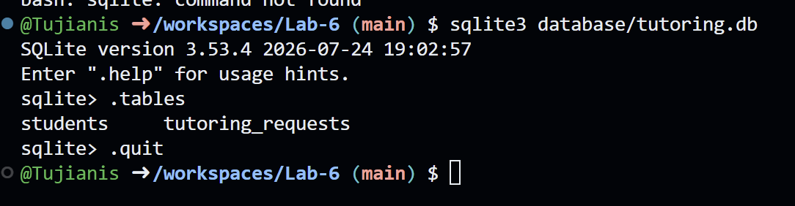
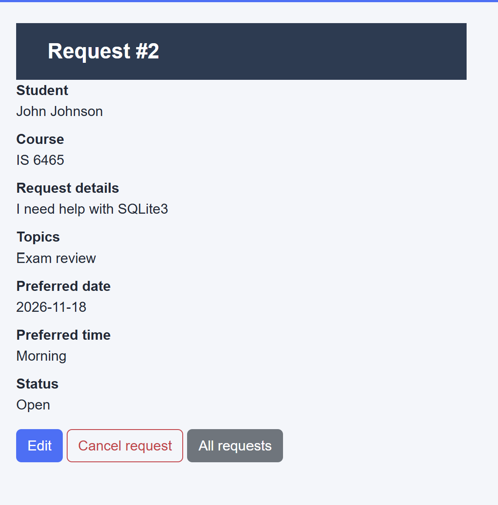
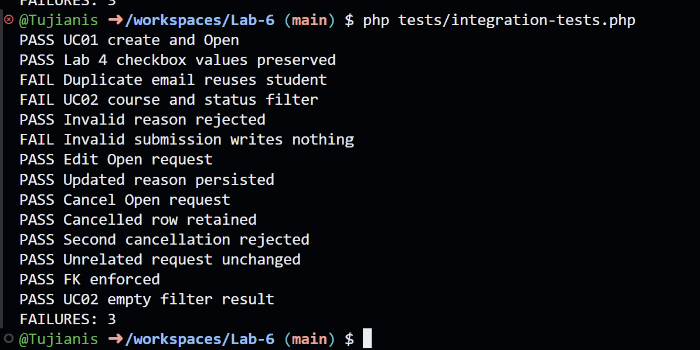

Part 1) Proof of DB and Tables: 

Part 2) 1) https://super-duper-train-q49wgwgv6v7cjg-8000.app.github.dev/php/request-details.php?request_id=2

2) The request was saved, screenshot below.

3) 

Part 3: 
Test | What I did  | Expected Result | Actual Result | Pass/Fail?

Submit Valid | Filled out form correctly | New request was created | A new request was created | Pass 
View All | Click on "View Requests | All Requests Appears | All requests appeared | Pass
Filter Requests | Filtered by Course | Filtered requests results show | The requests matching the filter show | Pass
Edit Open Request | Changed the description | The request is updated | The request was updated | Pass
Cancel Open Request | Clicked Cancel button, confimred cancel | The status changes to cancelled | The status was changed to cancelled | Pass
Try to change cancelled request | Tried to change the value like before | It wouldn't let me | There is no button to change the information | Pass

Part 4:
1) requests-details.php
2) process-request.php
3) requestService.php
4) requestService.php
5) request/studentPDO.php
6) student table
7) request table
8) It connects to the student through the student ID attached with the request

SQL statements belong in repo files because you want to have an air-gap between where your backend logic exists and where your dataase connection exists. It allows the ability to validate before needing to prepare the SQL statement in order to keep the DB as clean as possible.

Part 5)  The tests did not all pass. I did not change any of the files.

Part 6) I do not have an account with any AI company. As such, I cannot complete this using AI. I will do my best to do it manually.

Requirement | Application Page | Service or Validation | Repo/SQL | Database Table | Test evidence
Student submits requests | Request-Form.php | requestPDO.php | SQL | request table | A new request appears

I cannot ask what I do not have, but to answer the questions myself: 
One test I thought of was making sure that the correct accounts could view the correct requests. So one student could only view their own requests, but an admin could view all. The way you could test it would be to have a test user and a test admin and see what the return results give for each and compare. It could be applicable for role permission,s and I don't see it in the integration-tests.php. I think its appropriate as you want to make sure the idea of least privilege is applied always.

AI didn't help me because I didn't use it. Developers must always verify AI code, if you can't explain it, you shouldn't push it. Developer holds the responsibility for the code pushed from their account and for repositories they are responsible for.

Part 7: The join combines both tables together with the different column names, and joins it on the student_id which is a PK on the student table and an FK on the request table. It then orders it in ascending order by the request_id. For my part I would have done an inner join, since I'm mostly certain JOIN just does a left join instead of inner join, but I don't know SQLite well enough to know that yet.